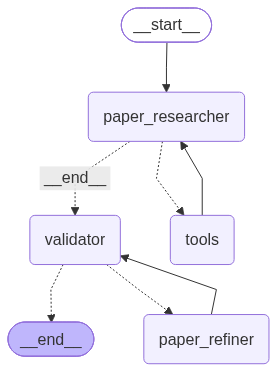
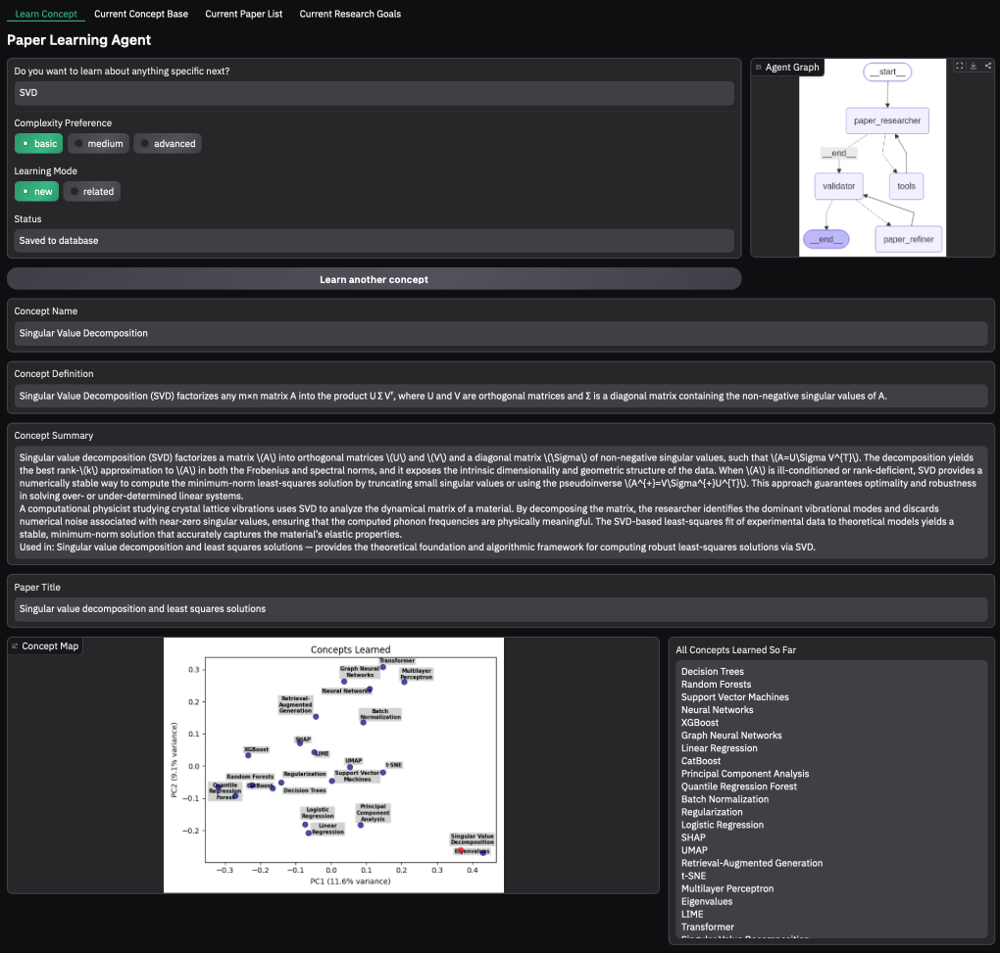

# Paper Agent by Tim Weichselberger
This project should help students learn different concepts in their domain. By defining their research goal, they can learn new concepts each backed with a relevant paper (to further study if interested) found with Semantic Scholar. All studied concepts are saved and visualized (PCA plot).

## 1 How it works


This agentic-workflow project consists of three agents: Paper-Researcher, Validator and Paper-Refiner.

- Paper-Researcher: Given the user's input it decides on the next concept to study. By utilizing the semantic-scholar-api the Paper-Researcher tries to find a canonical paper and outputs paper title, concept name, concept definition and concept summary in a JSON structure.

- Validator:
Checks whether the paper-title is the original one of the semantic-scholar-api, discards concepts that are already in the database (cosine distance of embeddings) and lets an LLM check whether the concept name, concept definition and concept summary are sufficient. If the Validator accepts the results produced by the Paper-Researcher or Paper-Refiner, it embeds the concepts and saves all information to the pgvector db. However, if there is a problem with the outputs, it rejects the information and assigns a correction to the Paper-Refiner.

- Paper-Refiner:
Sees all the search results of the Paper-Researcher and the rejection messages of the Validator and corrects the missing or incorrect information of the last iteration. The corrected information is sent back to the Validator.

## 2 Tech Stack
- Python 3.13:
    - LangGraph for agentic workflow
    - Gradio as frontend

- LLMs:
    - Groq gpt-oss-120b (Paper-Researcher)
    - Groq gpt-oss-20b (Validator, Paper-Refiner)
    - Gemini gemini-flash-latest (fallback if a Groq call fails, e.g. rate limits)

- Embeddings: Gemini gemini-embedding-2

- DB: PostgreSQL with pgvector

- Semantic Scholar API (paper search)
- Docker

## 3 Requirements for .env File (see .env.example)
- API-KEYS:
    - GROQ_API_KEY (https://console.groq.com/home - free tier is sufficient)
    - GOOGLE_API_KEY (https://aistudio.google.com - free tier is sufficient)
    - SEMANTIC_SCHOLAR_API_KEY (https://www.semanticscholar.org/product/api - free tier is sufficient)

- DB Information (choose any values):
    - POSTGRES_USER=
    - POSTGRES_PASSWORD=
    - POSTGRES_DB=

## 4 Docker Requirements
- Docker Desktop (or Docker Engine)
- Tested with Docker 29.5.3 and Docker Compose v5.1.4
- Docker must be running before starting the project

## 5 Start Project

```bash
git clone https://github.com/TimWeichsel/paper-agent.git
cd paper-agent
cp .env.example .env
# Fill in your API Keys (see section 3)
docker compose up --build
```
Then open http://localhost:7860
(Note: the first build takes a couple of minutes)

## 6 Usage
4 Tabs to use:
- Learn Concept - study a new concept by indicating search term, complexity preference, learning mode (complete new concept or related concept). It also visualizes a PCA (Principal Component Analysis) Plot of all concepts studied so far.
- Current Concept Base - See all so far studied concepts with their summary
- Current Paper List - All papers of the studied concepts
- Current Research Goals - Define your Research Goals so the agents find the right papers and concepts for you to study (START WITH THIS TAB FOR BEST RESULTS)



## 7 Limitations
- project runs in your Docker container and thus only via localhost
- rate-limits for free tier LLM plans might not be sufficient
- LLM models might be deprecated